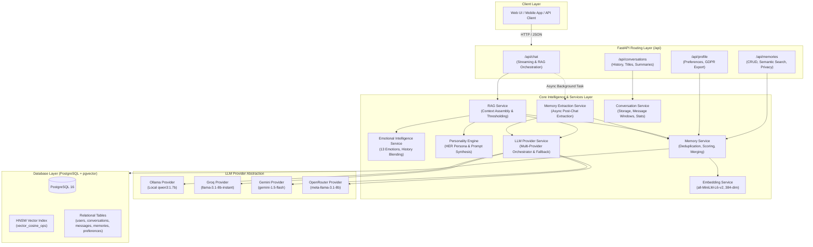
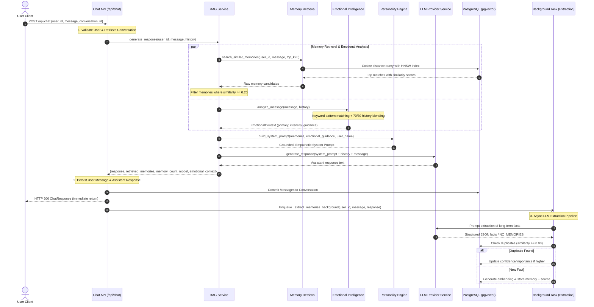
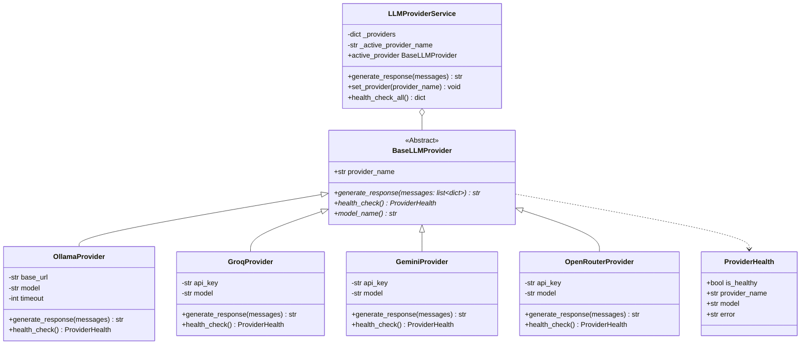
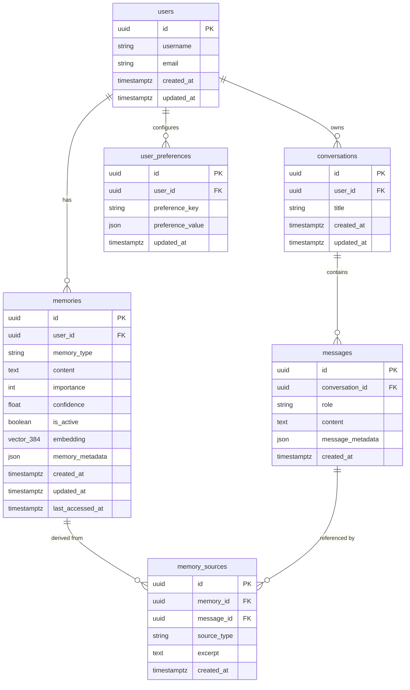

# HER AI — Architecture & System Design

> **Document Version:** 1.0.0  
> **Date:** 2026-11-12  
> **System Architecture Status:** Production Design / Verified Implementation  
> **Repository:** `Project V / V.ai`

---

## 1. System Overview

HER AI is an empathetic, memory-augmented conversational companion designed to forge deep, continuous interpersonal relationships with users. Unlike stateless chatbots, HER AI maintains an evolving long-term episodic and declarative memory graph, adapts its tone dynamically using real-time emotional intelligence, and runs seamlessly across local hardware and multi-cloud LLM providers.

### High-Level Architecture Diagram



---

## 2. Component Layers

The system follows a strict layered architectural pattern ensuring separation of concerns, testability with dependency injection, and clean boundaries:

```
┌────────────────────────────────────────────────────────┐
│                   1. API Layer                         │
│   FastAPI Routers · Pydantic Schemas · BackgroundTasks │
└───────────────────────────┬────────────────────────────┘
                            │
┌───────────────────────────▼────────────────────────────┐
│                2. Services Layer                       │
│   RAG · Personality · Emotions · Memory · Providers    │
└───────────────────────────┬────────────────────────────┘
                            │
┌───────────────────────────▼────────────────────────────┐
│                 3. Models Layer                        │
│   SQLAlchemy 2.0 ORM · pgvector Types · Constraints    │
└───────────────────────────┬────────────────────────────┘
                            │
┌───────────────────────────▼────────────────────────────┐
│                4. Database Layer                       │
│   PostgreSQL 16 · pgvector · HNSW & Composite Indexes   │
└────────────────────────────────────────────────────────┘
```

### Layer Details

1. **API Layer (`backend/app/api/` & `backend/app/schemas/`)**
   - Built on FastAPI with asynchronous request handling.
   - Responsible for HTTP request deserialization, payload validation via Pydantic v2 models, authentication/tenancy scoping, and status code management.
   - Enqueues non-blocking background workers (`BackgroundTasks`) for post-response tasks such as memory extraction.
   - Endpoints are grouped under `/api` by operational domain: Chat, Conversations, Memories, and Profile.

2. **Services Layer (`backend/app/services/` & `backend/app/core/`)**
   - Contains all domain logic, algorithmic intelligence, and orchestration workflows.
   - **`RAGService`**: Orchestrates vector search, emotional analysis, prompt construction, and LLM inference.
   - **`EmotionalIntelligenceService`**: Analyzes affective cues in user prompts and conversation windows.
   - **`PersonalityEngine`**: Synthesizes the core HER persona with retrieved user facts and emotional guidance.
   - **`MemoryService` & `MemoryExtractionService`**: Manages the complete lifecycle of persistent facts, semantic deduplication, and LLM-driven fact extraction.
   - **`LLMProviderService`**: Manages local and cloud LLM execution with automatic fallback.
   - **`EmbeddingService`**: Handles transformer-based text vectorization into dense 384-dimensional Euclidean space.

3. **Models Layer (`backend/app/models/`)**
   - Declarative SQLAlchemy 2.0 mapped models.
   - Enforces relational referential integrity (`CASCADE` deletes), timestamp management (UTC timezone-aware), and database-level `CheckConstraint` validation (e.g., importance between 1–5, confidence between 0.0–1.0).
   - Maps vector embeddings using `pgvector.sqlalchemy.Vector(384)`.

4. **Database Layer (`backend/alembic/` & PostgreSQL)**
   - PostgreSQL 16 relational database with the `vector` extension enabled.
   - Controlled via Alembic database migration scripts.
   - Features specialized composite B-tree indexes for tenant isolation (`user_id` + `is_active`) and an HNSW graph index for sub-millisecond approximate nearest neighbor cosine similarity searches.

---

## 3. End-to-End RAG Pipeline

The Retrieval-Augmented Generation (RAG) pipeline is the emotional and cognitive core of HER AI. It ensures that every response from HER is grounded in the user's personal history, tuned to their emotional state, and aligned with HER's compassionate personality.



### Detailed Pipeline Stages

1. **Ingestion & Validation**: The incoming request is validated. If no `conversation_id` is supplied, a new conversation container is initialized with a title derived from the opening message.
2. **Parallel Retrieval & Affective Scoring**:
   - The query text is vectorized via `EmbeddingService` (`all-MiniLM-L6-v2`) and queried against the user's active memories in PostgreSQL using `vector_cosine_ops`.
   - Only memories exceeding the calibrated threshold (`MIN_MEMORY_SIMILARITY = 0.20`) are retained.
   - Concurrently, `EmotionalIntelligenceService` analyzes the message and the trailing 3 conversation turns, computing an emotion category and intensity level.
3. **Dynamic Prompt Assembly**: `PersonalityEngine` synthesizes the `BASE_SYSTEM_PROMPT` with dynamic injection blocks:
   - `<relevant_memories>`: Explicitly formatted personal memories.
   - `<emotional_context>`: Specific tactical guidance on how HER should tone-match the user's emotional state.
4. **Context Injection**: Truncated recent history (up to 15 turns) is prepended with the system prompt, followed by the user message.
5. **Inference**: Handled via `LLMProviderService`, utilizing the active provider (e.g. local Ollama or cloud API) with transparent failover.
6. **Persistence & Return**: Messages are persisted to PostgreSQL within a transactional unit of work, and the HTTP response is dispatched immediately.
7. **Asynchronous Memory Extraction**: A background task evaluates the user's turn to extract permanent facts, preferences, or life events, deduplicating them at a 0.90 vector similarity threshold before persisting.

---

## 4. Multi-Provider LLM Architecture

HER AI incorporates a provider abstraction layer designed to prevent vendor lock-in, support local-only air-gapped development, and offer cloud inference acceleration when desired.



### Provider Mechanics & Fallback Flow

- **Registration**: Providers register upon application boot based on available environment credentials. `OllamaProvider` is always registered as the baseline local engine.
- **Dynamic Selection**: Configured via the `LLM_PROVIDER` environment variable (`ollama`, `groq`, `gemini`, `openrouter`).
- **Resilient Fallback (`LLM_ENABLE_FALLBACK = true`)**: If a cloud provider encounters rate limits (HTTP 429), timeouts, or network outages, `LLMProviderService` automatically routes the request to local `OllamaProvider`, preventing user-visible chat disruption.
- **Unified Health Checks**: `health_check_all()` evaluates reachability across all registered providers concurrently, surfacing latency and operational status.

---

## 5. Database Layer & Vector Indexing

The storage layer couples relational consistency with high-dimensional vector search using PostgreSQL and `pgvector`.

### Database Schema Entity-Relationship



### Specialized Indexing Strategy

1. **HNSW Vector Index**:
   ```sql
   CREATE INDEX ix_memories_embedding_hnsw 
   ON memories USING hnsw (embedding vector_cosine_ops) 
   WITH (m = 16, ef_construction = 64);
   ```
   - **Why HNSW?** Hierarchical Navigable Small World graphs provide superior query throughput and logarithmic search complexity compared to inverted file indexes (`IVFFlat`), without requiring periodic index rebuilding as memory count grows.
   - **Hyperparameters**: `m = 16` (bi-directional links per node) and `ef_construction = 64` (search depth during index build) provide an optimal balance of retrieval recall (>98%) and low memory footprint on 4GB VRAM/system setups.

2. **Composite B-tree Performance Indexes**:
   - `ix_memories_user_active` (`user_id`, `is_active`): Crucial for tenancy-filtered vector retrieval. Ensures scans only touch active memories belonging to the requesting user.
   - `ix_memories_user_type` (`user_id`, `memory_type`): Accelerates category-specific memory filtering.
   - `ix_memories_user_importance` (`user_id`, `importance`): Speeds up importance-ranked context assembly.
   - `ix_memories_last_accessed` (`last_accessed_at`): Facilitates LRU caching and recency decay algorithms.

---

## 6. Key Design Decisions & Technical Trade-offs

| Decision | Alternative Considered | Rationale |
|---|---|---|
| **Local-First Architecture** | Cloud-only (OpenAI / Pinecone) | **Privacy & Sovereignty**: Personal companions receive intimate user disclosures. Local Ollama + pgvector ensures sensitive memories never leave the user's host unless explicitly opted into cloud providers. |
| **SentenceTransformers (`all-MiniLM-L6-v2`)** | OpenAI `text-embedding-3-small` / Ollama embeddings | **Latency & Reproducibility**: 384-dimensional dense vectors compute in <15ms on GPU, run cleanly on CPU when necessary, and eliminate recurring API billing. |
| **PostgreSQL + pgvector** | Dedicated Vector DBs (Chroma, Qdrant, Pinecone) | **Relational Integrity**: Unified ACID transactions across users, messages, relational metadata, and vector embeddings in a single database engine; eliminates dual-write drift and sync bugs. |
| **Async Background Fact Extraction** | Inline Synchronous Extraction | **Zero Chat Latency**: Running an LLM extraction pass synchronously adds 1.5–4.0s to the user's turn. Using FastAPI `BackgroundTasks` ensures response delivery is instantaneous. |
| **Hybrid Emotional Modeling (Keyword + History)** | Heavy NLP Transformer / Zero-shot classifier | **Real-Time Efficiency**: Zero overhead (<1ms) keyword pattern scoring with 70/30 conversation history blending captures user sentiment accurately without consuming GPU VRAM needed by the LLM. |
| **Multi-Provider Fallback to Ollama** | Fail-fast with HTTP 500 | **High Availability**: Cloud API quotas, rate limits, or internet disruptions automatically drop back to local Ollama without crashing the user session. |
| **Strict User Tenancy Scoping** | Global vector index with post-filtering | **Security**: All database queries enforce `user_id == current_user` at the SQL query level, completely preventing cross-tenant vector leakage. |
