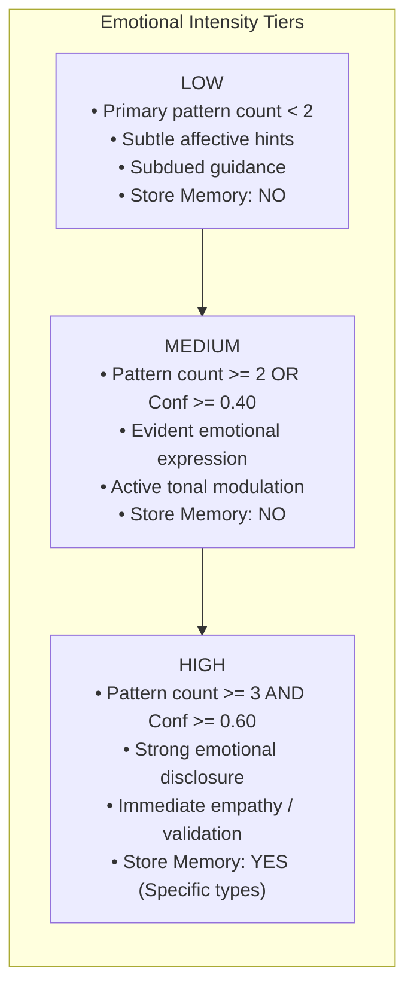
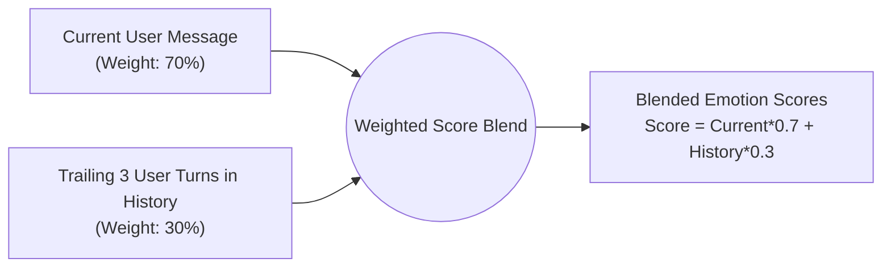
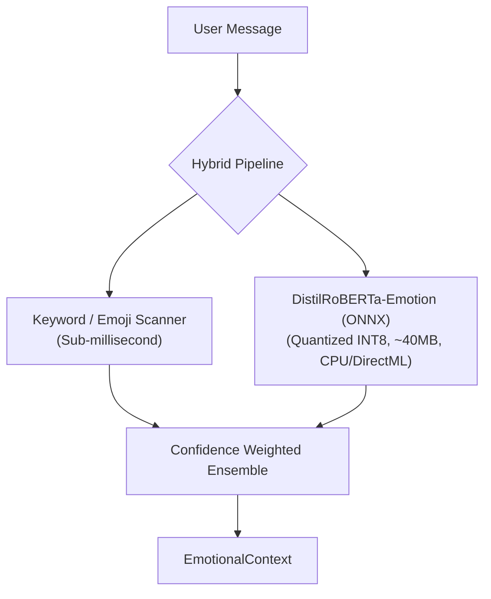

# HER AI — Emotional Intelligence Engine

> **Document Version:** 1.0.0  
> **Date:** 2026-11-12  
> **Status:** Production Architecture & Reference  
> **Service Implementation:** `backend/app/services/emotional_intelligence_service.py`

---

## 1. Executive Summary

The Emotional Intelligence (EI) Engine provides HER AI with the perceptual ability to detect affective signals, emotional subtext, and stress in user communication. Instead of responding with generic canned friendliness or cold robotic detachment, HER modulates its tone, pacing, empathy, and response approach in real-time to match the user's emotional state.

The current production system operates using high-speed, zero-dependency pattern matching augmented by **temporal history blending**, delivering affective awareness in sub-millisecond execution times without consuming GPU VRAM.

---

## 2. Emotion Categories & Taxonomy

HER AI recognizes **13 discrete affective categories** represented by the `Emotion` enum:

| Emotion Enum | Description | Key Indicators / Patterns | Default Affective Goal |
|---|---|---|---|
| `HAPPINESS` | Joy, satisfaction, contentment, positive news | *"happy", "wonderful", "amazing", "love it", ":)", "😊"* | Match energy; be warm, validating, and joyful |
| `SADNESS` | Grief, sorrow, emotional exhaustion, emptiness | *"sad", "depressed", "crying", "miss them", "empty", "💔"* | Deep presence; listen first; gentle warmth; no unsolicited solutions |
| `STRESS` | Cognitive overload, pressure, burnout, urgency | *"stressed", "overwhelmed", "deadline", "burnout", "can't cope"* | Grounding calmness; simplify responses; break tasks down |
| `ANXIETY` | Apprehension, fear, overthinking, dread | *"anxious", "worried", "scared", "what if", "overthinking"* | Reassurance; clarity; avoid adding ambiguity or complexity |
| `EXCITEMENT` | Anticipation, euphoria, celebration, milestones | *"so excited", "can't wait", "amazing news", "finally", "🎉"* | High enthusiastic resonance; share genuine excitement |
| `FRUSTRATION` | Irritation, blocked goals, system failures | *"frustrated", "annoyed", "why won't", "keeps failing", "useless"* | Validate frustration immediately; be patient and non-defensive |
| `LONELINESS` | Isolation, disconnection, social emptiness | *"lonely", "alone", "no friends", "invisible", "no one cares"* | Intimate presence; companionship; attentive listening |
| `CONFUSION` | Cognitive dissonance, ambiguity, feeling lost | *"confused", "don't understand", "makes no sense", "stuck"* | Step-by-step clarity; gentle patient explanations |
| `MOTIVATION` | Drive, ambition, determination, focus | *"motivated", "ready", "let's do", "won't give up", "making progress"* | High-energy encouragement; reinforce user's determination |
| `DISAPPOINTMENT`| Regret, missed expectations, letdown | *"disappointed", "let down", "didn't work out", "missed out"* | Compassionate acknowledgment; gentle perspective |
| `AFFECTION` | Fondness, personal care, warmth towards HER | *"love you", "care about", "mean a lot", "you understand me"* | Warm and heartfelt response without falsely claiming biological feelings |
| `GRATITUDE` | Appreciation, thankfulness, acknowledgment | *"thank you", "grateful", "appreciate", "helped me so much"* | Warm, humble, and gracious acceptance |
| `NEUTRAL` | Fact-based queries, operational inputs, no strong affect | Short inputs, queries, general statements | Balanced, friendly, natural conversational demeanor |

---

## 3. Emotional Intensity Levels

The engine computes an intensity score classified into three tiers via `EmotionalIntensity`:



- **`LOW`**: Subtle undertone. HER maintains its standard warm persona while gently softening or brightening its tone.
- **`MEDIUM`**: Clear affective state. Requires acknowledgment (`should_acknowledge = True`) and deliberate alignment with the prescribed response approach.
- **`HIGH`**: Acute emotional moment (deep sadness, intense stress, major celebration). Overrides generic responses. HER prioritizes emotional support, grounding, or celebratory resonance before addressing operational topics.

---

## 4. How Keyword & Pattern Analysis Works

The detection pipeline evaluates user input in four stages:

1. **Pre-filtering**: Messages shorter than 3 characters immediately return a neutral context.
2. **Normalized Multi-Pattern Matching**:
   The input string is lowercased and matched against a curated pattern dictionary `EMOTION_PATTERNS` containing over 140 keywords, colloquial idioms, and Unicode emojis (e.g. `😊`, `💔`, `🎉`, `😭`).
   ```python
   text_lower = text.lower()
   for emotion, patterns in EMOTION_PATTERNS.items():
       for pattern in patterns:
           if pattern in text_lower:
               scores[emotion] += 1.0
   ```
3. **Primary & Secondary Classification**:
   - The non-neutral emotion with the maximum match count becomes `primary_emotion`.
   - The runner-up emotions (up to 2) are captured as `secondary_emotions` (e.g., detecting both `STRESS` and `FRUSTRATION`).
4. **Confidence Computation**:
   Confidence is the ratio of primary signal to total observed affective signal:
   $$\text{confidence} = \min\left(1.0, \frac{\text{primary\_score}}{\max(\text{total\_score}, 1.0)} + \mathbf{1}_{\{\text{primary\_score} \ge 2\}} \times 0.2\right)$$

---

## 5. Temporal Conversation History Blending

Isolated single-turn evaluation often misclassifies brief user follow-ups (e.g. if a user discusses grief, and follows up with *"it really hurts"* or *"can't cope"*). HER AI solves this using **Conversation History Blending**:



### Algorithm
1. The service extracts up to 3 recent user messages from the trailing 6 turns in `conversation_history`.
2. A separate pattern analysis computes `history_scores`.
3. The final score for every candidate emotion is blended:
   $$\text{FinalScore}(e) = (\text{CurrentScore}(e) \times 0.7) + (\text{HistoryScore}(e) \times 0.3)$$
4. This ensures emotional inertia: HER remains aware of lingering distress or excitement even if the immediate message is short or elliptical.

---

## 6. The `EmotionalContext` Data Model

The result of an analysis is encapsulated in an `EmotionalContext` dataclass:

```python
@dataclass
class EmotionalContext:
    primary_emotion: Emotion               # Dominant detected emotion
    confidence: float                      # Bounded score between 0.0 and 1.0
    intensity: EmotionalIntensity          # LOW, MEDIUM, or HIGH
    secondary_emotions: list[Emotion]      # Up to 2 secondary affective states
    relevant_context: str                  # Diagnostic string for logging
    response_approach: str                 # Tactical directive for LLM generation
    should_acknowledge: bool               # True if intensity is MEDIUM or HIGH
    store_as_memory: bool                  # True if eligible for long-term memory
```

---

## 7. System Prompt Injection

When emotional signals are detected (`confidence >= 0.30` and `primary_emotion != Emotion.NEUTRAL`), the service formats a directive string via `format_for_prompt()`:

```python
"The user appears to be feeling stress (high intensity). The user seems overwhelmed. Respond calmly and gently. Help them feel less alone with the situation. Break things into smaller pieces."
```

This directive is injected into the `<emotional_context>` section of HER's system prompt by `PersonalityEngine.build_system_prompt()`.

### Guidance Matrix Excerpt

| Emotion | Intensity | Directive Injected Into Prompt |
|---|---|---|
| `SADNESS` | `HIGH` | *"The user seems to be going through something painful. Listen first. Acknowledge their feelings warmly before anything else. Do not offer solutions unless asked."* |
| `STRESS` | `HIGH` | *"The user seems overwhelmed. Respond calmly and gently. Help them feel less alone with the situation. Break things into smaller pieces."* |
| `FRUSTRATION` | `HIGH` | *"The user is quite frustrated. Validate their frustration before anything else. Do not be dismissive."* |
| `HAPPINESS` | `HIGH` | *"The user is in a great mood. Match their energy. Be warm and enthusiastic."* |
| `AFFECTION` | `HIGH` | *"The user is expressing strong affection. Respond warmly and genuinely without pretending to have human feelings."* |

---

## 8. Storing Emotional Memories

Not all emotional moments are ephemeral. Severe emotional events (such as the loss of a loved one, high stress before an exam, or a triumphant career breakthrough) should be remembered.

The engine sets `store_as_memory = True` when:
1. `intensity == EmotionalIntensity.HIGH`
2. `primary_emotion` belongs to `{SADNESS, STRESS, DISAPPOINTMENT, EXCITEMENT, MOTIVATION}`
3. The user message length exceeds 20 characters (`len(message.strip()) > 20`)

When these criteria are met, the background extraction worker records the event under the category `emotional_experience` with `importance >= 4`, allowing HER to recall the event weeks later (*"How are you holding up since that difficult week last month?"*).

---

## 9. Current Limitations & Architectural Boundary

While the keyword-based approach provides distinct advantages (<1ms latency, zero GPU VRAM consumption, 100% determinism), it possesses known architectural limitations:
- **No Semantic Disambiguation**: Sarcasm (*"Oh wonderful, my hard drive just crashed"*) or negation (*"I am not happy about this"*) can register false positives if keywords appear.
- **Vocabulary Specificity**: Affective states expressed through nuanced metaphors without explicit dictionary keywords can be classified as `NEUTRAL`.
- **Language Boundary**: Currently optimized primarily for English idioms and international emojis.

---

## 10. Recommended Future Evolution: Local ML Classifier

To maintain sub-10ms response times while achieving deep semantic sentiment understanding, the recommended path forward is integrating a compact local ONNX-quantized transformer:



- **Target Architecture**: `distilroberta-base-emotion` or `GoEmotions` fine-tuned model exported to ONNX INT8.
- **Resource Footprint**: <50MB RAM, CPU-executable via `onnxruntime` with ~8ms latency, zero GPU contention.
- **Capabilities Gained**: Accurate detection of subtle emotional expressions, implicit sarcasm handling, and nuanced multi-label affective classification.
