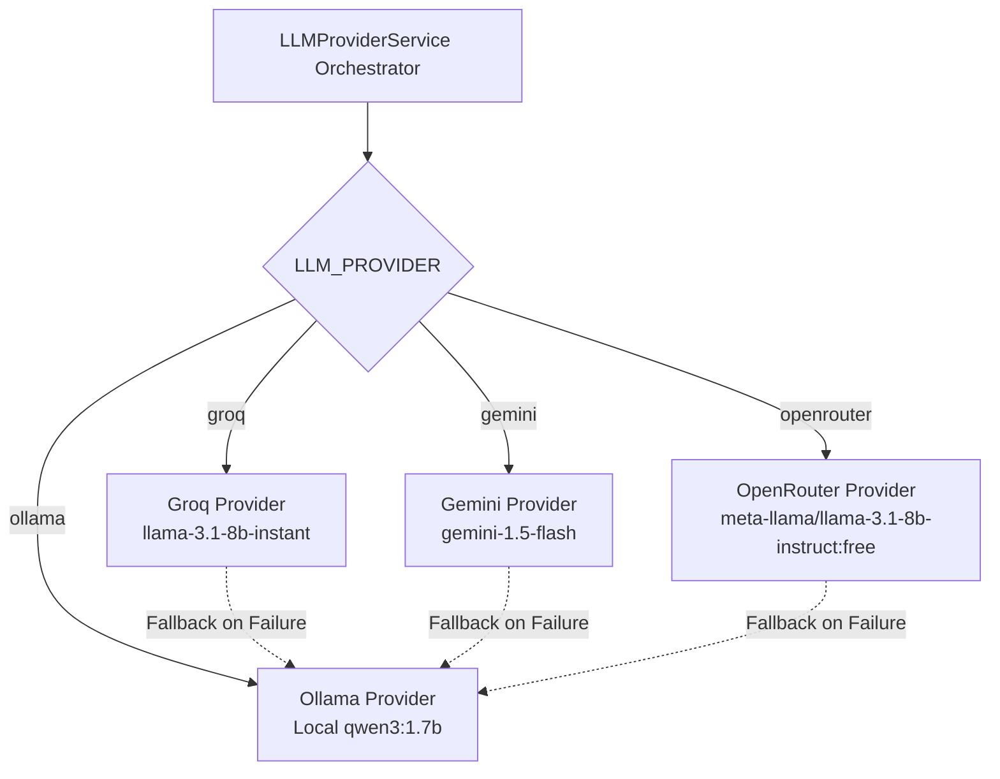

# HER AI — Multi-Provider LLM Architecture

> **Document Version:** 1.0.0  
> **Date:** 2026-11-12  
> **Status:** Production Architecture & Integration Guide  
> **Module Location:** `backend/app/services/llm_providers/` & `backend/app/services/llm_provider_service.py`

---

## 1. Architectural Philosophy

HER AI is designed around a **privacy-first, vendor-neutral LLM abstraction layer**. Conversational agents should not be tied to a single cloud vendor or model family. The system accommodates:
1. **Local-Only Operation (Zero Cloud Dependency)**: Developers and privacy-conscious users can run HER AI entirely on-device using Ollama and local sentence transformers with zero network leakage.
2. **Accelerated Cloud Inference**: Users seeking higher conversational intelligence or lower latency on non-GPU hardware can leverage Groq, Google Gemini, or OpenRouter.
3. **Resilient Automated Failover**: If a cloud provider encounters rate limiting, billing blocks, or network failures, the orchestrator seamlessly falls back to local Ollama.

---

## 2. The Provider Abstraction

All LLM drivers inherit from the abstract base class `BaseLLMProvider` located in `backend/app/services/llm_providers/base.py`:

```python
from abc import ABC, abstractmethod
from dataclasses import dataclass

@dataclass
class ProviderHealth:
    is_healthy: bool
    provider_name: str
    model: str
    error: str | None = None

class BaseLLMProvider(ABC):
    provider_name: str = "base"

    @abstractmethod
    async def generate_response(self, messages: list[dict]) -> str:
        """Generate response from a list of {role: str, content: str} dicts."""

    @abstractmethod
    async def health_check(self) -> ProviderHealth:
        """Verify reachability and credential validity."""

    @property
    @abstractmethod
    def model_name(self) -> str:
        """Return the current model identifier."""
```

---

## 3. Supported Providers

HER AI ships with four production-tested provider implementations:



### 1. Ollama (`OllamaProvider`) — Local Default
- **Role**: Primary local inference engine and universal fallback.
- **Protocol**: HTTP REST API (`/api/chat`) with retry backoff.
- **Default Model**: `qwen3:1.7b` (optimized for 4GB VRAM like NVIDIA RTX 3050).
- **Network Footprint**: 100% offline; calls `http://localhost:11434`.
- **Health Check**: Pings `GET /api/tags` to ensure the Ollama daemon is active and the requested model is pulled.

### 2. Groq (`GroqProvider`) — High-Speed Cloud
- **Role**: Ultra-fast inference with sub-second time-to-first-token.
- **Protocol**: OpenAI-compatible HTTP REST API (`https://api.groq.com/openai/v1/chat/completions`).
- **Default Model**: `llama-3.1-8b-instant`.
- **Authentication**: Bearer token via `GROQ_API_KEY`.
- **Health Check**: Sends a 1-token diagnostic completion request (`"ping"`).

### 3. Google Gemini (`GeminiProvider`) — Multimodal & Nuanced
- **Role**: High contextual reasoning and expansive context windows.
- **Protocol**: Google Gemini REST API (`https://generativelanguage.googleapis.com/v1beta/models/{model}:generateContent`).
- **Default Model**: `gemini-1.5-flash`.
- **Authentication**: Query parameter `?key={GEMINI_API_KEY}`.
- **Role Translation**: Automatically maps standard OpenAI-style roles (`system`, `user`, `assistant`) to Gemini's native API schema (`contents` with `user` and `model` roles, plus `systemInstruction`).

### 4. OpenRouter (`OpenRouterProvider`) — Universal Multi-Model
- **Role**: Broad access to open-weights models and zero-cost community endpoints.
- **Protocol**: OpenAI-compatible endpoint (`https://openrouter.ai/api/v1/chat/completions`).
- **Default Model**: `meta-llama/llama-3.1-8b-instruct:free`.
- **Authentication**: Bearer token via `OPENROUTER_API_KEY`.

---

## 4. Environment Configuration Reference

All provider configurations are declared in `.env` (derived from `.env.example`):

```bash
# =================================================================
# LLM Provider Selection & Resilience
# =================================================================
# Active provider: "ollama" | "groq" | "gemini" | "openrouter"
LLM_PROVIDER=ollama
LLM_ENABLE_FALLBACK=true

# =================================================================
# Local LLM — Ollama
# =================================================================
OLLAMA_BASE_URL=http://localhost:11434
OLLAMA_MODEL=qwen3:1.7b
OLLAMA_TIMEOUT_SECONDS=120

# =================================================================
# Cloud Provider: Groq (Optional)
# =================================================================
GROQ_API_KEY=gsk_your_groq_api_key_here
GROQ_MODEL=llama-3.1-8b-instant

# =================================================================
# Cloud Provider: Google Gemini (Optional)
# =================================================================
GEMINI_API_KEY=AIzaSy_your_gemini_api_key_here
GEMINI_MODEL=gemini-1.5-flash

# =================================================================
# Cloud Provider: OpenRouter (Optional)
# =================================================================
OPENROUTER_API_KEY=sk-or-v1-your_openrouter_api_key_here
OPENROUTER_MODEL=meta-llama/llama-3.1-8b-instruct:free
```

---

## 5. Provider Selection & Fallback Behavior

### Dynamic Orchestration Flow

`LLMProviderService` in `backend/app/services/llm_provider_service.py` manages active providers:

1. **Bootstrapping**:
   - `OllamaProvider` is initialized unconditionally.
   - Cloud providers are instantiated **only if** their respective API keys are present in the environment.
   - If the requested `LLM_PROVIDER` is missing credentials, the service automatically defaults to `"ollama"`.
2. **Runtime Failover (`LLM_ENABLE_FALLBACK = true`)**:
   ```python
   async def generate_response(self, messages: list[dict]) -> str:
       try:
           return await self.active_provider.generate_response(messages)
       except Exception as primary_error:
           if settings.LLM_ENABLE_FALLBACK and self._active_provider_name != "ollama":
               try:
                   logger.warning(
                       "Primary provider %s failed (%s). Falling back to Ollama.",
                       self._active_provider_name, primary_error
                   )
                   return await self._providers["ollama"].generate_response(messages)
               except Exception:
                   pass
           raise primary_error
   ```
   - Cloud rate limits, 502 bad gateways, or network drops are caught transparently.
   - The user's query is re-routed to the local Ollama instance without terminating the chat turn.

---

## 6. Health Checks & Diagnostics

`LLMProviderService` provides a unified diagnostic method `health_check_all()` that tests all registered engines concurrently via `asyncio.gather()`:

```python
health_results = await llm_provider_service.health_check_all()
```

### Response Structure Example
```json
{
  "ollama": {
    "is_healthy": true,
    "provider_name": "ollama",
    "model": "qwen3:1.7b",
    "error": null
  },
  "groq": {
    "is_healthy": true,
    "provider_name": "groq",
    "model": "llama-3.1-8b-instant",
    "error": null
  },
  "gemini": {
    "is_healthy": false,
    "provider_name": "gemini",
    "model": "gemini-1.5-flash",
    "error": "HTTP 400: API_KEY_INVALID"
  }
}
```

---

## 7. Local-Only Mode (Zero Cloud Footprint)

By default, HER AI operates in **Local-Only Mode**:
- Set `LLM_PROVIDER=ollama`.
- Leave `GROQ_API_KEY`, `GEMINI_API_KEY`, and `OPENROUTER_API_KEY` empty.
- **Operational Reality**:
  - Sentence embeddings (`all-MiniLM-L6-v2`) run locally on GPU or CPU.
  - LLM inference runs locally via the Ollama process on `localhost:11434`.
  - Vector similarity search runs in the local PostgreSQL instance.
  - **No telemetry, prompts, memories, or profile data leave the machine.**

---

## 8. Step-by-Step Guide: Adding a New Provider

Adding a custom provider (e.g. Anthropic Claude, Mistral, or a custom vLLM server) requires three straightforward steps:

### Step 1: Implement the `BaseLLMProvider` Subclass
Create `backend/app/services/llm_providers/custom_provider.py`:

```python
from app.services.llm_providers.base import BaseLLMProvider, ProviderHealth
import httpx

class CustomProvider(BaseLLMProvider):
    provider_name: str = "custom"

    def __init__(self, endpoint: str, api_key: str, model: str):
        self._endpoint = endpoint
        self._api_key = api_key
        self._model = model

    @property
    def model_name(self) -> str:
        return self._model

    async def generate_response(self, messages: list[dict]) -> str:
        async with httpx.AsyncClient(timeout=60.0) as client:
            resp = await client.post(
                self._endpoint,
                headers={"Authorization": f"Bearer {self._api_key}"},
                json={"model": self._model, "messages": messages}
            )
            resp.raise_for_status()
            return resp.json()["choices"][0]["message"]["content"]

    async def health_check(self) -> ProviderHealth:
        try:
            # Simple probe
            return ProviderHealth(is_healthy=True, provider_name=self.provider_name, model=self._model)
        except Exception as e:
            return ProviderHealth(is_healthy=False, provider_name=self.provider_name, model=self._model, error=str(e))
```

### Step 2: Add Configuration to `Settings`
In `backend/app/core/config.py`:
```python
CUSTOM_API_KEY: str | None = None
CUSTOM_MODEL: str = "custom-v1"
CUSTOM_ENDPOINT: str = "https://api.custom.ai/v1/chat"
```

### Step 3: Register in `LLMProviderService`
In `backend/app/services/llm_provider_service.py`:
```python
from app.services.llm_providers.custom_provider import CustomProvider

def _initialize_providers(self) -> None:
    # Existing registrations...
    if settings.CUSTOM_API_KEY:
        self._providers["custom"] = CustomProvider(
            endpoint=settings.CUSTOM_ENDPOINT,
            api_key=settings.CUSTOM_API_KEY,
            model=settings.CUSTOM_MODEL
        )
```

---

## 9. Privacy & Data Transmission Notice

> [!WARNING]
> **Data Transmission Scope with Cloud Providers:**
> When `LLM_PROVIDER` is set to `groq`, `gemini`, or `openrouter`, the user's prompt **and all retrieved personal memories included in the system prompt** are transmitted over TLS to the third-party cloud API for inference.
> 
> If strict data privacy, HIPAA, or air-gapped isolation is required:
> 1. Keep `LLM_PROVIDER=ollama`.
> 2. Ensure all cloud API keys remain unpopulated in `.env`.
> 3. Verify in `/health` that only `ollama` is active.
