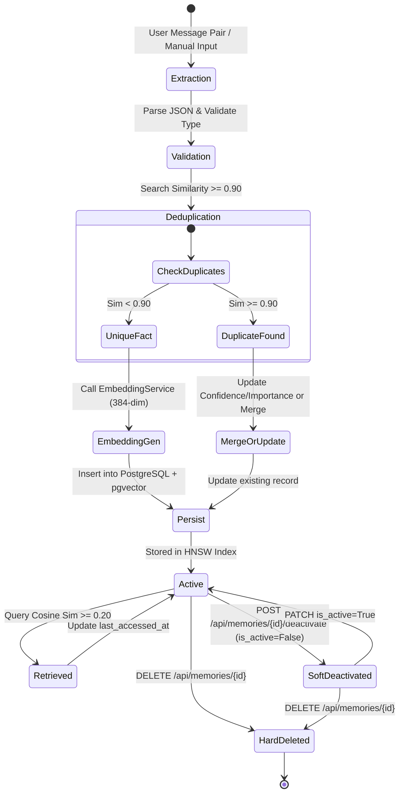
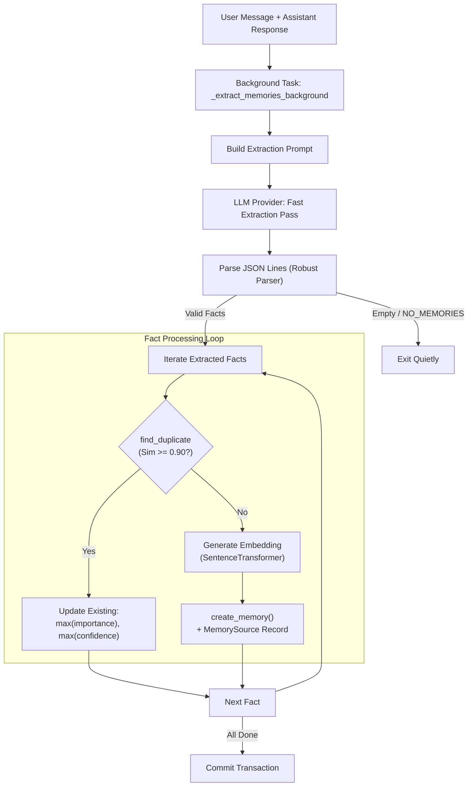

# HER AI — Memory System Specification

> **Document Version:** 1.0.0  
> **Date:** 2026-11-12  
> **Status:** Production Architecture & API Reference  
> **Repository:** `Project V / V.ai`

---

## 1. Executive Overview

The HER AI Memory System enables persistent, lifelong conversational continuity. Rather than storing unbounded, noisy chat transcripts in context, the system extracts, vectorizes, indexes, and selectively recalls high-fidelity semantic facts about the user. 

The memory engine operates on three foundational principles:
1. **Fact Extraction Over Transcript Accumulation**: Chats are ephemeral sessions; memories are concise declarative facts distilled from conversation.
2. **Deterministic Relevance Filtering**: Semantic similarity with pgvector cosine distance, calibrated against real embeddings.
3. **User Sovereignty & Privacy by Design**: Complete user control over memories through soft deactivation, permanent deletion, mass wipe, and GDPR-compliant JSON data exports.

---

## 2. Memory Taxonomy (19 Categories)

Every memory in HER AI is classified into one of 19 strictly validated categories defined in `app.services.memory_service.VALID_MEMORY_TYPES`.

| Category | Description | Example Content | Typical Importance (1–5) |
|---|---|---|---|
| `personal_info` | Core identity, demographics, location, and background | *"User is from Bangalore, India"* | 4–5 |
| `personality_trait` | Inferred or stated temperament, habits, and mindset | *"User is introspective and values thoughtful discussions"* | 3–4 |
| `communication_preference`| Tone, brevity, and interaction styles preferred by user | *"User prefers concise bullet points when discussing technical topics"* | 3–4 |
| `like` | Positive preferences, foods, media, and tools | *"User loves Italian food and dark roast coffee"* | 2–3 |
| `dislike` | Aversions, negative preferences, pet peeves | *"User strongly dislikes micromanagement and syntax ambiguity"* | 2–3 |
| `hobby` | Leisure activities and creative pursuits | *"User enjoys landscape photography on weekends"* | 2–3 |
| `interest` | Topics, technologies, and intellectual curiosities | *"User is fascinated by distributed systems and neural radiance fields"* | 3–4 |
| `career_goal` | Professional aspirations, targets, and desired roles | *"User wants to become a Senior AI Systems Engineer"* | 5 |
| `dream` | Visionary long-term life aspirations | *"User dreams of building an open-source robotics research lab"* | 4–5 |
| `ambition` | High-drive, near-to-mid term milestones | *"User is aiming to publish a research paper in NeurIPS next year"* | 4–5 |
| `life_event` | Significant past or present biographical occurrences | *"User transitioned from mechanical engineering to software in 2024"* | 4–5 |
| `relationship` | Family, friends, mentors, partners, and colleagues | *"User has a younger brother named Aryan who is in college"* | 3–4 |
| `emotional_experience` | Vulnerable moments, breakthroughs, or hardships | *"User experienced deep grief after losing their childhood pet"* | 4–5 |
| `important_conversation`| Pivotal discussions or agreements made with HER | *"User decided to take a sabbatical to focus on health after our discussion"* | 3–4 |
| `daily_experience` | Routine happenings with episodic significance | *"User started going for 5km morning jogs before work"* | 2–3 |
| `future_plan` | Concrete planned events or upcoming commitments | *"User is traveling to Tokyo for two weeks this December"* | 3–4 |
| `learning_progress` | Skill acquisition and educational tracking | *"User is studying Rust memory management models"* | 3–4 |
| `milestone` | Achievements, anniversaries, and accomplishments | *"User passed their machine learning certification exam"* | 4–5 |
| `general` | Default category for unclassified valid user facts | *"User prefers working in dim ambient lighting"* | 2–3 |

---

## 3. The Memory Lifecycle



### Lifecycle Phases

1. **Extraction / Ingestion**: Facts are captured either automatically via background LLM extraction following user turns or manually via `POST /api/memories`.
2. **Validation**: All inputs are checked against database check constraints:
   - `content`: Non-empty string (up to 5,000 characters).
   - `importance`: Integer bounded strictly between `1` and `5`.
   - `confidence`: Float bounded strictly between `0.0` and `1.0`.
   - `memory_type`: Must belong to `VALID_MEMORY_TYPES`.
3. **Deduplication Check**: Before inserting, the content is checked against existing memories for semantic equivalence using vector similarity at a **0.90 threshold**.
4. **Vector Embedding**: Dense 384-dimensional representations are computed via `all-MiniLM-L6-v2`.
5. **Persistence**: The record is committed along with its embedding and provenance metadata (`MemorySource`).
6. **Active Retrieval**: During chat generation, active memories are searched using vector cosine similarity. When a memory is injected into prompt context, its `last_accessed_at` timestamp is updated.
7. **Deactivation / Merging**: Outdated or conflicting memories can be soft-deleted (`is_active = False`) or merged into a primary memory record.
8. **Permanent Deletion**: Hard deletion permanently purges the memory and cascades deletion to linked `MemorySource` records.

---

## 4. Automatic Extraction Pipeline

Memory extraction operates **asynchronously in the background** via FastAPI `BackgroundTasks`, executing immediately after the chat response is dispatched to the user.



### Extraction System Prompt

The extractor LLM uses a specialized prompt (`EXTRACTION_SYSTEM_PROMPT`) instructing it to act as a strict biographical analyst:
- Extracts **only permanent, long-term personal facts**.
- Explicitly rejects transient states (*"I am tired today"*, *"It is raining"*).
- Outputs line-delimited JSON objects with `content`, `memory_type`, `importance`, `confidence`, and `excerpt`.
- Emits `NO_MEMORIES` when no durable facts are shared.

### Fault Tolerance & Robust Parsing

The `_parse_extraction_response` method incorporates defense-in-depth parsing:
- Strips markdown formatting (e.g. ` ```json ` blocks).
- Parses line-by-line; ignores malformed lines while accepting valid ones.
- Clamps out-of-range values (e.g. importance `> 5` is clamped to `5`).
- Re-maps unrecognized memory types to `"general"`.

---

## 5. Duplicate Detection & Merging Strategy

To prevent memory store pollution from repeated mentions (e.g. the user stating *"I am an AI engineer"* across multiple chats), HER AI enforces semantic deduplication:

### 1. Vector Duplicate Detection
```python
duplicate = memory_service.find_duplicate(
    db=db,
    user_id=user_id,
    content=content,
    memory_type=memory_type,
    similarity_threshold=0.90,
)
```
- A cosine similarity threshold of **`0.90`** defines semantic duplicates.
- The comparison requires an exact category match (`memory_type`).

### 2. Duplicate Resolution Logic
When an incoming extracted fact matches an existing memory at `similarity >= 0.90`:
- **No new record is created.**
- The existing record's importance is upgraded: `importance = max(existing.importance, incoming.importance)`.
- The existing record's confidence is upgraded: `confidence = max(existing.confidence, incoming.confidence)`.
- The `updated_at` timestamp is refreshed.

### 3. Memory Merging (`merge_memories`)
When consolidating two distinct memories (e.g. via an administrative or pruning process):
- Primary record retains the highest importance and confidence.
- Secondary record is soft-deactivated (`is_active = False`).
- The primary record's `memory_metadata` records the audit trail under `"merged_from"` with the subordinate memory's ID, content, and timestamp.

---

## 6. Retrieval Strategy & Calibrated Thresholds

HER AI executes vector similarity retrieval using pgvector cosine distance:

$$\text{cosine\_distance} = 1 - \frac{\vec{u} \cdot \vec{v}}{\|\vec{u}\| \|\vec{v}\|}$$
$$\text{similarity} = 1 - \text{cosine\_distance}$$

### Calibrated Retrieval Thresholds

```
Cosine Similarity Scale:
0.00 ──────────── 0.15 ────── 0.20 ──────────────────────── 0.90 ──────────── 1.00
 No Correlation    Noisy Match │ RAG Retrieval Threshold     │ Duplicate Match  Exact
 (Ignored)         (Filtered)  ▼ (Injected into System)     ▼ (Merged)
```

- **`MIN_MEMORY_SIMILARITY = 0.20`**:
  - Extensive calibration against real embeddings (`all-MiniLM-L6-v2`) demonstrated that semantic matches for short conversational queries (e.g. *"What career goal did I previously share?"* vs *"User wants to become an AI engineer"*) yield similarity scores in the **0.23 – 0.27 range**.
  - Setting the retrieval threshold higher (such as 0.50 or 0.70) causes false-negative recall failures.
  - Setting the threshold at `0.20` eliminates semantic noise while consistently pulling the intended memories.
- **`RAG_TOP_K = 5`**: Retrieves up to 5 top candidate memories per turn to maintain prompt conciseness.
- **Combined Ranking Score (`search_memories`)**:
  When manual search is performed via API, memories are re-ranked using a composite formula weighing semantic similarity and declared importance:
  $$\text{Score} = \text{similarity} \times \left(0.8 + 0.2 \times \frac{\text{importance}}{5}\right)$$

---

## 7. Importance & Confidence Scales

### Importance Scale (Integer 1 to 5)

| Level | Classification | Meaning | Retention Priority |
|:---:|---|---|---|
| **5** | **Critical / Life-Altering** | Core identity, primary career goals, family loss, major values | Always injected when retrieved |
| **4** | **High Significance** | Major relationships, strong passions, key career moves, core dislikes | High retrieval priority |
| **3** | **Moderate Significance** | Hobbies, general preferences, current projects, pet names | Standard retrieval |
| **2** | **Minor Detail** | Specific foods liked, transient daily routines, passing observations | Low retrieval priority |
| **1** | **Trivial** | Casual ephemeral mentions with marginal long-term value | Candidate for decay/pruning |

### Confidence Scale (Float 0.0 to 1.0)

- **`1.0`**: Explicit first-person declaration by the user (*"My name is Vivek and I am an engineer"*).
- **`0.8 – 0.95`**: Direct extraction from unambiguous conversational statements.
- **`0.5 – 0.79`**: Inferred context or emotional deduction.
- **`< 0.50`**: Ambiguous or uncertain context; rejected by extraction filters.

---

## 8. Database Indexing & Performance Architecture

To maintain sub-50ms retrieval latencies across thousands of user memories, HER AI applies specialized database indexes defined in Alembic migration `a1b2c3d4e5f6`:

```sql
-- 1. HNSW Vector Index for Cosine Approximate Nearest Neighbor
CREATE INDEX IF NOT EXISTS ix_memories_embedding_hnsw 
ON memories USING hnsw (embedding vector_cosine_ops) 
WITH (m = 16, ef_construction = 64);

-- 2. Tenant Isolation & Active State
CREATE INDEX ix_memories_user_active 
ON memories (user_id, is_active);

-- 3. Category Filter Optimization
CREATE INDEX ix_memories_user_type 
ON memories (user_id, memory_type);

-- 4. Importance Rank Ordering
CREATE INDEX ix_memories_user_importance 
ON memories (user_id, importance);

-- 5. Recency & Access Auditing
CREATE INDEX ix_memories_last_accessed 
ON memories (last_accessed_at);
```

### Why HNSW over IVFFlat?
1. **Zero Downtime**: IVFFlat requires creating an index only after substantial data is populated and demands periodic `REINDEX` operations as data clusters shift. HNSW builds iteratively from the very first memory insert.
2. **Superior Recall**: HNSW graphs achieve >98% recall at low search latency, avoiding misses on vital personal facts.

---

## 9. Privacy, Data Sovereignty & GDPR Compliance

Personal memory storage requires rigorous data sovereignty guarantees. HER AI exposes comprehensive privacy controls:

| Operation | Endpoint | Mechanism | Result |
|---|---|---|---|
| **Export All Data** | `GET /api/memories/export?user_id=` | Full JSON dump | Returns complete archive of all active memories, types, and timestamps. |
| **Soft Deactivate** | `POST /api/memories/{id}/deactivate?user_id=` | Sets `is_active = False` | Memory is hidden from RAG retrieval and list queries, but preserved in history. |
| **Hard Delete** | `DELETE /api/memories/{id}?user_id=` | SQL `DELETE` | Permanent unrecoverable deletion; cascades to `memory_sources`. |
| **Purge All Memories** | `DELETE /api/memories/all?user_id=` | Bulk delete on user scope | Wipes 100% of the user's memories in a single atomic transaction. |
| **Account Privacy Export** | `GET /api/profile/export?user_id=` | GDPR Export | Bundles user profile, preferences, and all memories into a downloadable JSON artifact. |
